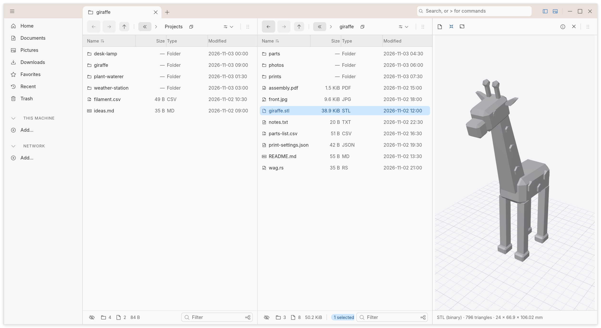
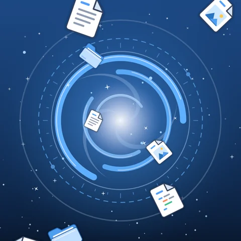

# Rick

Rick is a fast, lean file manager for professionals. It runs on Linux, macOS and Windows from a single codebase and behaves the same on all three. A small core does the basics; everything else comes from an extensible plugin ecosystem.

<!-- generated:status -->
v0.4.1 · Rick is early and not fully tested yet, so expect bugs. Tab navigation and some performance work are still unfinished. Please help us find what's broken and tell us what you see.

[Download v0.4.1](#install) for Linux, macOS or Windows, try it, and tell us [what breaks](https://github.com/Open-Breach/rick/issues). [Opinions](https://github.com/Open-Breach/rick/issues) welcome too, good or bad, as long as they're respectful.
<!-- /generated:status -->

## Why Rick exists

I think AI is going to be the biggest accelerator open source has ever had. Open source always carried one handicap: it could never throw the resources at a project that a big company can. That is changing.

I worked on Windows for years before moving to Linux. I expected to tinker and fight to make things work. Instead I found a polished experience that simply worked; it's a viable alternative today. But one thing from my earlier life I kept missing was Windows Explorer, a good file manager, even if there was room for improvement. Then I started using macOS more and more, and I don't like Finder either.

I also believe more and more people will move to Linux, and those coming from Windows are used to the mouse and a graphical interface, not just the console. They'll need a powerful file manager. So I decided to build my own. That's how Rick came about.

## Features

<!-- generated:features -->
- **Previews 87 file types**, listed by kind below.
- **Multi-pane, multi-tab view:** split panes side by side, drag them around, keep as many tabs as you like.
- **Browses** local disks, Archives, SSH, ZFS and the cloud (S3, Azure Blob, Google Cloud Storage), and **searches** through Tracker and Baloo on Linux, Spotlight on macOS and Windows Search on Windows.
- **Works with the tools you already use**, like Git and SVN: status badges in the file list and actions in the context menu.
- **Installs and uninstalls software distributed as tarballs**, so a tar.gz download becomes a managed install instead of a folder you forget about. Linux only.
- **Small things done right**, such as computing a file's hash from the context menu.
<!-- /generated:features -->

<!-- generated:file-types -->
<details open>
<summary>Media (17)</summary>

JPG, PNG, GIF, BMP, WebP, TIFF, SVG, MP3, WAV, MP4, M4A, MOV, AVI, CUR, ICNS, ICO, XPM

</details>

<details>
<summary>Documents (18)</summary>

PDF, Markdown, HTML, CSV, TSV, TXT, LOG, RST, NFO, SRT, VTT, DOCX, XLSX, PPTX, ODT, ODS, ODP, EPUB

</details>

<details>
<summary>3D (3)</summary>

STL, OBJ, 3MF

</details>

<details>
<summary>Programming (27)</summary>

INI, CFG, CONF, TOML, Diff, .gitignore, .env, JavaScript, TypeScript, Java, Rust, C#, F#, Visual Basic, C, C++, Perl, PHP, JSON, XML, YAML, Shell, Python, Ruby, Go, CSS, SQL

</details>

<details>
<summary>Archives and disk images (22)</summary>

ZIP, JAR, WAR, EAR, APK, XPI, 7z, RAR, ISO, TAR, TAR.GZ, TAR.ZST, TAR.XZ, TAR.BZ2, TAR.LZ4, IMG, DMG, VHD, VHDX, VMDK, VDI, QCOW2

</details>
<!-- /generated:file-types -->

Coming:

- Distribution images: an installer or a package for each platform, signed.
- Further bug fixes.

<picture>
  <source media="(prefers-color-scheme: dark)" srcset="docs/screenshots/readme-dark.png">
  
</picture>

## Install

<!-- generated:install -->
**Linux** · [x64](https://github.com/Open-Breach/rick/releases/download/v0.4.1/rick-0.4.1-linux-x64.tar.gz) · [arm64](https://github.com/Open-Breach/rick/releases/download/v0.4.1/rick-0.4.1-linux-arm64.tar.gz)

```bash
tar xzf rick-0.4.1-linux-x64.tar.gz && ./rick-0.4.1-linux-x64/rick
```

Needs glibc 2.39 or later (Ubuntu 24.04). The first start offers to set Rick up in your desktop: the launcher entry, the default file manager, the `rick` command.

**macOS** · [arm64](https://github.com/Open-Breach/rick/releases/download/v0.4.1/rick-0.4.1-macos-arm64.zip)

Unzip, drag `Rick.app` to Applications and open it. The app is not notarised yet: allow it under System Settings → Privacy & Security.

**Windows** · [x64](https://github.com/Open-Breach/rick/releases/download/v0.4.1/rick-0.4.1-windows-x64.zip)

Unpack and run `rick.exe`. SmartScreen may warn the first time.

Office documents preview through LibreOffice when it is installed; on Linux, audio and video need the GStreamer plug-ins.

Plugins ship in the archive's `plugins/` folder; delete a plugin's folder and that plugin is gone.
<!-- /generated:install -->

> **Use with caution.** Rick is written largely by an AI coding agent working from [SPEC.md](SPEC.md), with human review, a strict test gate and CI on all three platforms. That makes it fast to build and easy to audit, but it is still young software whose entire purpose is to move, rename and delete your files. Until 1.0, run it on data you have backed up, prefer *Move to trash* over *Delete permanently*, and treat every release as a preview. If it does something surprising, that's a bug: please report it.

## Join in

Rick is open source under [Apache-2.0](LICENSE) and we want company.

- **Try it and tell us.** Open an issue for anything that feels slow, wrong or missing. Performance complaints are especially welcome; they come with numbers.
- **Ask questions.** Ambiguities in the spec are raised as [issues](https://github.com/Open-Breach/rick/issues). Add yours.
- **Review the code.** Because so much of it is agent-written, a second pair of human eyes on any pull request is worth more here than in most projects. Read a crate, question a design, poke at an edge case.
- **Build something.** Pick a crate, read its one-paragraph README, and send a pull request. The engineering rules are short and in SPEC.md; CI checks them on Linux, macOS and Windows.
- **Write a module.** The five traits are small enough to fit on one screen each. A previewer for your favourite format is a great first contribution, and it ships as a module people can switch on.

Contributions are accepted under the same Apache-2.0 license.

<p align="center">
  
</p>

---

[Building from source](docs/building.md) · [The command line](docs/command-line.md) · [The architecture](docs/architecture.md) · [The changelog](CHANGELOG.md)

Licensed under [Apache-2.0](LICENSE).

*Named after a certain genius scientist who refuses to accept that anything is impossible. The file manager is ours; the name is a nod.*
